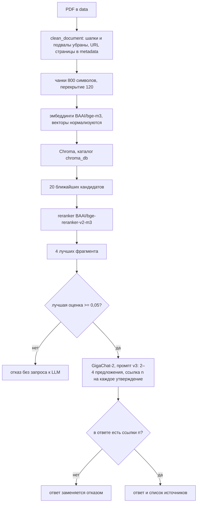

# ФинЩит

Telegram-бот отвечает на вопросы о мошенничестве по открытым PDF Банка России, а не по памяти модели. Это самостоятельный проект: материалы регулятора, не сервис конкретного банка.

Ищет фрагменты, отсекает посторонние темы порогом релевантности и просит модель сослаться на источник. Если ссылки нет, человек видит отказ.

## С чего начать

Локальный запуск: скопировать `.env.example` в `.env`, заполнить `GIGACHAT_CREDENTIALS` и `TELEGRAM_TOKEN`, положить PDF из `data/SOURCES.md` в `data/`, затем `python ingest.py` и `python bot.py`. Команды целиком — в разделе «Как запустить».

Оценка без бота: `python evaluate.py eval/questions.json` и `python evaluate.py eval/questions_hard.json`. Скрипт считает поиск (hit rate, MRR) и ответы (faithfulness, ложные и правильные отказы). Числа разделов 1–3 — ниже и в `eval/experiments.md`.

Судья перед показом по умолчанию выключен. Мягкий режим, когда он нужен: `PRESHOW_JUDGE=1`. Повторить прогон: `python eval/preshow_experiment.py`. Дословный режим и отдельный порог 0,2 для этого шага не выбраны.

На одном мягком прогоне судья не показал ловушку «Что делать, если у меня украли телефон с банковским приложением?» и не отклонил ни одного из 32 показанных вопросов, ответ на которые есть в документах. Задержка почти вдвое. Среднее обычного набора (9,841 с и 16,019 с) тянет вверх первая строка, холодный старт 110,959 с; без неё отношение средних около 1,83, медиана — почти вдвое. Шаг в боте оставлен выключенным. Таблица — раздел 4 `eval/experiments.md`.

## Как это работает

PDF из `data/` проходят такой конвейер (числа сверены с `config.py` и значениями по умолчанию в `rag.py`):



Порог `RELEVANCE_THRESHOLD = 0.05`, модель `GigaChat-2`, промпт `PROMPT_VERSION = "v3"`, проверка ссылок `REQUIRE_CITATIONS = True`. Двадцать кандидатов и четыре фрагмента в контексте — аргументы по умолчанию `retrieve_scored` в `rag.py`. Если лучшая оценка ниже порога, функция `answer` возвращает отказ и модель не вызывается. Если модель ответила без ссылок `[n]`, этот текст заменяется отказом. В промптах v2 и v3 сама модель при отказе пишет служебное слово `НЕТ_ОТВЕТА`, а полный текст отказа подставляет код.

Отдельный шаг «судья перед показом» по умолчанию выключен (`PRESHOW_JUDGE` пустой). Когда он включён, GigaChat-2-Max сверяет черновик, который бот собирается показать, с найденными фрагментами и при вердикте «нет» заменяет ответ отказом. На схеме выше этот шаг не нарисован: в текущем контуре его нет. Результат одного мягкого прогона — в начале файла и в разделе 4 `eval/experiments.md`.

## Оценка

| Набор | С ответом | Без ответа | Что проверяет |
| --- | --- | --- | --- |
| `eval/questions.json` | 32 | 10 | вопросы близко к тексту документов; ловушки — посторонние темы и близкие темы без ответа |
| `eval/questions_hard.json` | 34 | 8 | 12 перефразировок, 8 вопросов на советы, 8 на точные факты, 6 на несколько документов, 8 ловушек |

В `questions.json` десять вопросов без источника разобраны полем `type`: 4 со значением `no_answer` и 6 со значением `off_topic`. В трудном наборе категории лежат в поле `category`: `paraphrase`, `advice`, `detail`, `multi_doc`, `trap`.

| Метрика | Простыми словами | Лучше, если |
| --- | --- | --- |
| Hit rate@4 | Доля вопросов, где нужный документ попал в 4 найденных фрагмента | выше |
| MRR | Насколько высоко стоит нужный фрагмент: 1 — первым, 0,5 — вторым и так далее | выше |
| Faithfulness | Доля ответов, где все утверждения подтверждаются найденными фрагментами | выше |
| Ложные отказы | Доля вопросов с ответом в документах, на которые бот отказался | ниже |
| Правильные отказы | Доля вопросов без ответа в документах, на которые бот отказался | выше |

Faithfulness считает судья: ему дают найденные фрагменты и ответ, вопрос не показывают. Судья — `GigaChat-2-Max`, `temperature = 0` (`config.py`, `components.get_judge`). Сверка с ручной разметкой — `judge_check.py` и `eval/judge_check.csv`: совпали 32 из 32 заполненных строк. В `eval/experiments.md` отмечено, что судья непостоянен на одинаковых ответах и может пропустить одно лишнее утверждение, поэтому faithfulness — оценка сверху.

95% интервалы в `evaluate.py` — бутстреп, 5000 повторов, `seed = 0`. В CSV поиска при полном попадании интервал схлопывается в `[1.00; 1.00]`, без reranker там стоит `[0.91; 1.00]` (`eval/retrieval_questions.csv`, `eval/retrieval_questions_hard.csv`). `eval/experiments.md` для случая «все ответы верные» указывает правило трёх: нижняя граница `1 − 3/n`. В коде `bootstrap_ci` это правило не применяется.

## Результаты

Числа ниже взяты из разделов 1–3 `eval/experiments.md`. Поиск там округлён до двух знаков; те же прогоны в CSV дают доли 31/32 и 33/34 без округления.

### Поиск

Порог и промпт на поиск не влияют.

| Набор | Hit rate@4 без reranker | Hit rate@4 с reranker | MRR без / с reranker |
| --- | --- | --- | --- |
| `questions.json` | 0,97 (31 из 32) | 1,00 (32 из 32) | 0,92 / 0,95 |
| `questions_hard.json` | 0,97 (33 из 34) | 1,00 (34 из 34) | 0,90 / 0,96 |

### Порог на трудном наборе

| Порог | Прогонов | Ложные отказы | Правильные отказы | Faithfulness |
| --- | --- | --- | --- | --- |
| 0,2 | 4 | 0,09 (3 из 34) | 1,00 | 1,00 |
| 0,1 | 1 | 0,06 (2 из 34) | 1,00 | 1,00 |
| 0,05 | 3 | 0,00 | 0,88 / 1,00 / 0,88 | 1,00 |

### Промпт и проверка ссылок при пороге 0,05

| Вариант | Промпт | Проверка ссылок |
| --- | --- | --- |
| A | v1 — исходный | нет |
| D | v2 — без готового совета, ссылка на каждое утверждение, разрешён частичный ответ | да |
| v3 | v2 + ответ в 2–4 предложениях: суть и советы | да |

| Вариант | Набор | Прогонов | Faithfulness | Ложные отказы | Правильные отказы | Средняя длина ответа |
| --- | --- | --- | --- | --- | --- | --- |
| A | трудный | 3 | 1,00 | 0,00 | 0,88 / 1,00 / 0,88 | — |
| A | обычный | 1 | 0,94 | 0,00 | 0,90 | — |
| D | трудный | 3 | 0,97 / 1,00 / 1,00 | 0,00 | 1,00 | 153 символа |
| D | обычный | 1 | 1,00 | 0,00 | 0,90 | 149 символов |
| v3 | трудный | 1 | 1,00 | 0,00 | 1,00 | 230 символов |
| v3 | обычный | 1 | 1,00 | 0,00 | 0,90 | 267 символов |

### Итоговая конфигурация

- `RELEVANCE_THRESHOLD = 0.05`
- `PROMPT_VERSION = "v3"`
- `REQUIRE_CITATIONS = True`
- проверка ответа судьёй перед показом выключена; если её включать, режим мягкий (раздел 4 в `eval/experiments.md`)

## Главные выводы

1. Поиск упёрся в потолок: с reranker нужный документ есть в топ-4 у всех вопросов обоих наборов (hit rate@4 = 1,00). Дальше сравниваются настройки генерации.
2. Трудный набор нашёл ложные отказы из-за порога: при 0,2 их 0,09 (3 из 34), это одни и те же перефразировки во всех прогонах.
3. Один порог не разделяет вопросы и ловушки на обоих наборах. Порог 0,08 на трудном наборе разделил бы всё идеально, но ловушка обычного набора «украли телефон» получает 0,128, а три вопроса с ответом из трудного — 0,084, 0,098 и 0,144. Порог снижен до 0,05, пограничные случаи решает модель.
4. Промпт v3 и проверка ссылок дали 0 ложных отказов на обоих наборах. В `eval/experiments.md` новые ответы описаны как в 1,5–1,8 раза длиннее коротких ответов варианта D.
5. Ловушка «Что делать, если у меня украли телефон?» по-прежнему проходит проверку ссылок: модель ставит ссылку на нерелевантный фрагмент (случай 9 в `eval/error_analysis.md`). Мягкий судья перед показом в одном прогоне этот черновик спрятал и верные ответы не тронул. В боте шаг выключен из-за задержки.

Разбор десяти ошибок, со статусом:

| № | Что произошло | Чья ошибка | Статус |
| --- | --- | --- | --- |
| 1 | Бот назвал номер ЦБ номером банка | системы | очистка шапок PDF в `ingest.py` |
| 2 | Отказ не распознан оценкой | оценки | проверка «в документах нет» |
| 3 | Ответ со ссылками засчитан как отказ | оценки | функция `is_refusal` |
| 4 | Верным считался только один документ | разметки | список верных источников |
| 5 | Совет из колонки «Что предпринять?» не попадает в контекст | системы | частично: промпт v2 без готового совета |
| 6 | Бот исказил факт из фрагмента | системы | нет, в новых прогонах не встречалось |
| 7 | Порог отсекает перефразированные вопросы | системы | порог 0,05, решает модель |
| 8 | Частичный ответ на ловушку засчитан как ошибка | оценки | описано, метрика не менялась |
| 9 | Ссылка есть, а опоры на документ нет | системы | мягкий судья спрятал в одном прогоне; в боте выключен |
| 10 | Судья непостоянен и пропускает мелкие добавки | оценки | ограничение метрики |

Полный разбор — в `eval/error_analysis.md`.

## Ограничения

- Порог и промпт подобраны на тех же наборах, на которых посчитаны итоговые метрики. Отложенного набора нет, поэтому цифры оптимистичны.
- Hit rate считается по совпадению документа, а не страницы или фрагмента. Для вопросов на несколько документов засчитывается любой найденный.
- Размер чанков и перекрытие не исследовались: в `config.py` стоят только 800 и 120.
- Наборы маленькие, по 42 вопроса. Разница в 1–2 вопроса незначима. Варианты v3 и проверка на обычном наборе — один прогон.
- Faithfulness — оценка сверху. Полнота и полезность ответа не измеряются; длина ответа — грубая замена.
- В конфигурации по умолчанию ловушка «украли телефон» проходит со ссылкой на нерелевантный фрагмент (случай 9). Опциональный мягкий судья в одном прогоне её спрятал. Задержка при этом почти вдвое выше, повторных прогонов нет.
- Docker, агент на LangGraph и эксперимент с промпт-инъекциями не сделаны. Они перечислены в разделе «Планы». В зависимостях есть пакет `langgraph`, кода агента нет. Файл `.dockerignore` есть, `Dockerfile` нет.

## Как запустить

Проект проверен на Python 3.13, версии зависимостей зафиксированы.

```bash
python -m venv .venv
source .venv/bin/activate
pip install -r requirements.txt
```

Пакет `gigachat` нужен скрипту `list_models.py`.

Тесты:

```bash
pip install -r requirements-dev.txt
python -m pytest tests
```

Дальше скопируйте `.env.example` в `.env` и заполните `GIGACHAT_CREDENTIALS` и `TELEGRAM_TOKEN`. PDF положите в `data/` под именами из `data/SOURCES.md` (сами файлы в git не входят) и соберите индекс.

```bash
python ingest.py
python rag.py
python bot.py
python evaluate.py eval/questions_hard.json
python evaluate.py eval/questions_hard.json --retrieval-only
```

`python rag.py` задаёт вопросы в консоли, пустая строка завершает цикл. `python bot.py` запускает Telegram-бота. `evaluate.py` без `--retrieval-only` дополнительно считает faithfulness по черновику без судьи перед показом и пишет `eval/answers_<имя файла>.csv`.

Проверка черновика перед показом (раздел 4 в `eval/experiments.md`, там же таблица одного мягкого прогона):

```bash
python eval/preshow_experiment.py
python eval/preshow_experiment.py --runs 3
python eval/preshow_experiment.py --strictness verbatim
PRESHOW_JUDGE=1 python bot.py
```

По умолчанию сверка по смыслу, и именно она выбрана после прогона. Дословный режим — `--strictness verbatim` или `PRESHOW_STRICTNESS=verbatim` — в журнале отложен. `PRESHOW_JUDGE` пустой, пока его не поставить в `1`. Скрипт пишет `eval/preshow_questions.csv` и `eval/preshow_questions_hard.csv` и печатает доли прохода, полосу top_score 0,05–0,15 отдельно для всех вопросов и для вопросов с ответом в документах, решение по случаю 9 и среднюю задержку. Готовые CSV этого прогона лежат рядом со скриптом.

В `components.py`, `list_models.py`, `pilot_batch.py` и `test_llm.py` у клиента GigaChat стоит `verify_ssl_certs=False`. Сертификат API выпущен НУЦ Минцифры и не входит в стандартный набор доверенных сертификатов Python (пакет `certifi`), поэтому проверка по умолчанию обрывает соединение. Так делать в постоянной настройке не стоит: проверка отключена целиком. Правильный путь — скачать корневой сертификат НУЦ Минцифры и передать его клиенту, включив проверку. В установленных `gigachat` и `langchain-gigachat` для этого есть аргумент `ca_bundle_file`:

```python
GigaChat(
    credentials=config.GIGACHAT_CREDENTIALS,
    scope="GIGACHAT_API_PERS",
    model=config.GIGACHAT_MODEL,
    verify_ssl_certs=True,
    ca_bundle_file="russian_trusted_root_ca.cer",
)
```

Тот же аргумент нужен и судье в `get_judge`. Код репозитория по-прежнему запускается с `verify_ssl_certs=False`.

Вопросы в `logs/questions.csv` пишутся без привязки к аккаунту. Цифры номеров карт и телефонов в этой таблице скрываются. В модель уходит исходный текст вопроса: он нужен для ответа.

## Структура репозитория

- `README.md` — это описание.
- `docs/EXPLANATION_ru.md` — разбор теории, кода и частые вопросы.
- `bot.py` — Telegram-бот: вопрос уходит в `answer`, в лог пишется замаскированная копия.
- `config.py` — ключи из `.env`, модели, размер чанка, порог, версия промпта.
- `components.py` — ленивые клиенты эмбеддингов, Chroma, reranker, GigaChat и судьи.
- `rag.py` — поиск, промпты v1–v3, ответ, ссылки и отказ.
- `ingest.py` — чтение PDF, очистка шапок, нарезка, запись индекса.
- `evaluate.py` — hit rate, MRR, бутстреп, faithfulness, отказы. Черновик без судьи перед показом.
- `preshow.py` — промпт судьи перед показом, разбор вердикта, замена черновика отказом.
- `judge_check.py` — выгрузка ответов и сверка офлайн-судьи faithfulness с ручной колонкой.
- `misses.py` — печать промахов поиска и ошибок отказа по `questions.json`.
- `score_check.py` — печать оценки reranker на нескольких фразах.
- `search_test.py` — пробный поиск Chroma без reranker.
- `list_models.py` — список моделей GigaChat через пакет `gigachat`.
- `test_llm.py` — один пробный запрос к GigaChat.
- `pilot_batch.py` — пакетный запрос к GigaChat по `pilot/queries.json`; каталог `pilot/` в git не входит, результатов в репозитории нет.
- `requirements.txt` — прямые зависимости с версиями.
- `requirements-dev.txt` — те же зависимости плюс pytest.
- `.env.example` — `GIGACHAT_CREDENTIALS`, `TELEGRAM_TOKEN`, пустые `PRESHOW_JUDGE` и `PRESHOW_STRICTNESS`.
- `.gitignore` — секрет, PDF, индекс, логи, служебные файлы macOS.
- `.dockerignore` — список исключений для образа; `Dockerfile` в репозитории нет.
- `data/SOURCES.md` — 17 PDF Банка России: имя файла, название, ссылка на страницу.
- `tests/test_mask.py` — тесты маскирования карт, телефонов и коротких чисел.
- `tests/test_preshow.py` — тесты вердикта и фильтра перед показом без API.
- `eval/experiments.md` — журнал экспериментов и план.
- `eval/preshow_experiment.py` — прогон до/после судьи перед показом на обоих наборах.
- `eval/preshow_questions.csv`, `eval/preshow_questions_hard.csv` — один мягкий прогон: черновик, вердикт, оценка, задержка.
- `eval/error_analysis.md` — разбор десяти ошибок.
- `eval/questions.json` — обычный набор, 42 вопроса.
- `eval/questions_hard.json` — трудный набор, 42 вопроса.
- `eval/queries_example.json` — образец формата пилотных запросов; вредные формулировки заменены заглушками.
- `eval/judge_check.csv` — ответы, вердикт судьи и ручная колонка.
- `eval/retrieval_questions.csv` — hit rate и MRR на обычном наборе.
- `eval/retrieval_questions_hard.csv` — hit rate и MRR на трудном наборе.
- `eval/retrieval_results.csv` — таблица поиска того же вида; числа совпадают с `retrieval_questions.csv`.
- `eval/answers_questions_run3.csv`, `eval/answers_questions_run4.csv`, `eval/answers_questions_run5.csv`, `eval/answers_questions_run6.csv` — сохранённые прогоны ответов на `questions.json`.
- `eval/answers_questions_hard_run1.csv`, `eval/answers_questions_hard_run2.csv`, `eval/answers_questions_hard_run3.csv` — сохранённые прогоны ответов на трудном наборе.
- `eval/answers_questions_hard_thr005_run1.csv`, `eval/answers_questions_hard_thr005_run2.csv`, `eval/answers_questions_hard_thr005_run3.csv` — трудный набор, порог 0,05.
- `eval/answers_questions_hard_thr010.csv` — трудный набор, порог 0,1.
- `eval/answers_questions_D.csv` — обычный набор, вариант D.
- `eval/answers_questions_hard_D_run1.csv`, `eval/answers_questions_hard_D_run2.csv`, `eval/answers_questions_hard_D_run3.csv` — трудный набор, вариант D.
- `eval/answers_questions_v3.csv` — обычный набор, промпт v3.
- `eval/answers_questions_hard_v3.csv` — трудный набор, промпт v3.

В git не входят `.env`, PDF в `data/`, индекс `chroma_db/`, `logs/` и каталог `pilot/`.

## Планы

Из таблицы «План дальнейших экспериментов» в `eval/experiments.md`:

| Эксперимент | Что меняем | Статус |
| --- | --- | --- |
| Порог релевантности | 0,2 → 0,1 → 0,05 | сделано, выбран 0,05 |
| Промпт и проверка ссылок | v1 → v2 → v3, проверка ссылок | сделано, выбран v3 |
| Вклад промпта и проверки по отдельности | варианты без одной из мер | не сделано |
| Проверка ответа судьёй перед показом | мягкая сверка показанного черновика | сделано, один прогон; в боте выключен |
| Порог 0,2 перед этим судьёй | отдельный порог до генерации | отложено |
| Дословный судья перед показом | `PRESHOW_STRICTNESS=verbatim` | отложено |
| Соседние чанки | + соседние чанки того же документа | не сделано, против случая 5 |
| Температура 0 | `temperature = 0` у бота | не сделано |
| Размер чанков | `CHUNK_SIZE` = 500 и 1200 | не сделано |
| Перекрытие | `CHUNK_OVERLAP` = 200 | не сделано |

Отдельно, и тоже не сделано:

- образ Docker;
- агент на LangGraph;
- эксперимент с промпт-инъекциями на локальной Qwen (`LOCAL_MODEL = "qwen2.5-7b-instruct"` в `config.py` только называет модель для режима `LLM_PROVIDER=local`).
